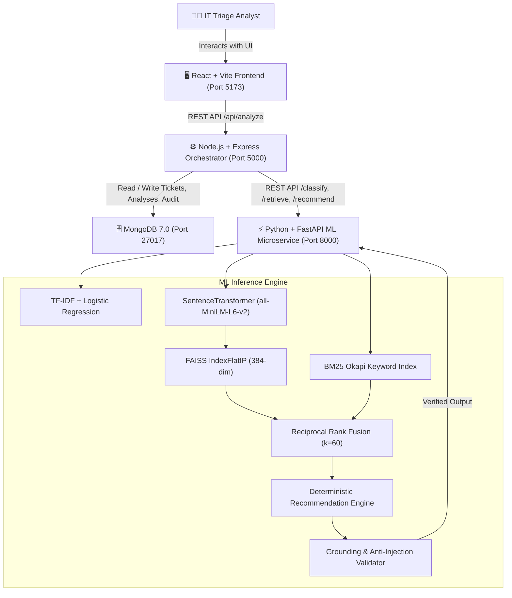
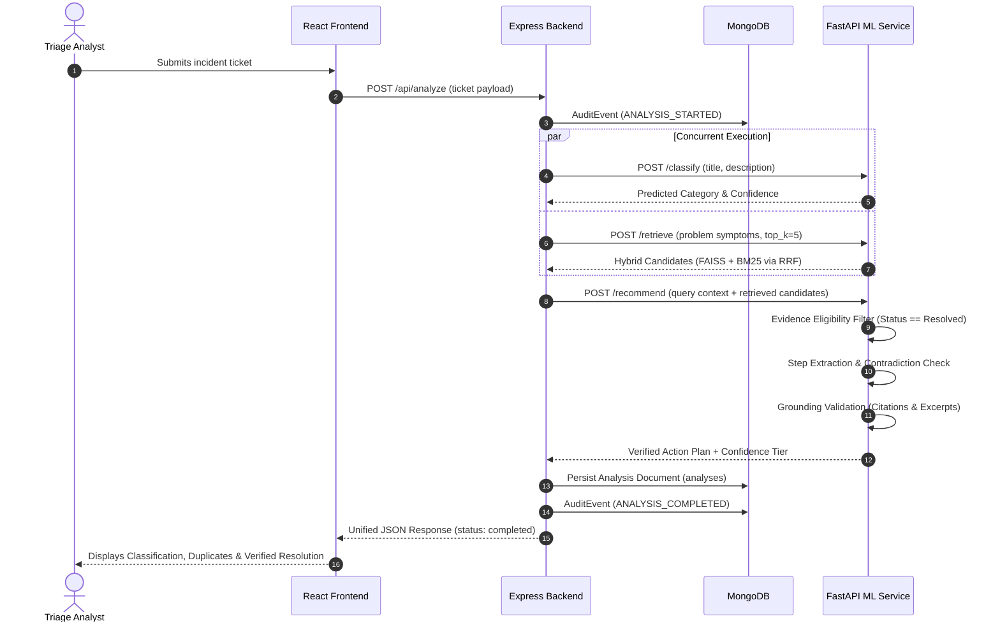

# System Architecture Documentation

**Project**: Intelligent IT Ticket Analysis and Resolution Assistant  
**Hackathon**: HCLTech Future Ready AI Engineer Hackathon  
**Target Domain**: Enterprise IT Service Management (ITSM) Autonomous Incident Triage  

---

## 1. High-Level Architecture Overview

The system is designed as a modular, three-tier microservice architecture adhering strictly to the separation of concerns:
- **Presentation Tier**: React 18 + Vite SPA offering an interactive, responsive console for triage analysts.
- **Orchestration Tier**: Node.js + Express.js backend serving as the central orchestration controller, state manager, access control enforcement gate, and MongoDB persistence layer.
- **AI/ML Inference Tier**: Python 3.11 + FastAPI microservice dedicated to feature extraction, embedding generation, dense vector search, lexical ranking, and recommendation synthesis.
- **Persistence Tier**: MongoDB 7.0 database acting as the sole persistent source of truth for historical incident records, AI analyses, analyst feedback, and immutable compliance audit trails.

---

## 2. Tier Responsibilities

### 2.1 React Frontend (`frontend/`)
- Controlled ticket ingestion form with 5 one-click realistic incident presets.
- Classification badge display (Category, Subcategory, Priority, Intent, Confidence).
- Hybrid Similar Tickets list featuring potential duplicate badges and match explanations.
- Grounded Suggested Resolution cards featuring numbered remediation plans and clickable source citations.
- Inline Analyst Feedback modal (FR-06) for marking recommendations as `useful`, `incorrect`, or `unresolved`.
- Historical Analysis records browser and Compliance Audit Trail viewer (FR-08).

### 2.2 Node.js Express Backend (`backend/`)
- Central orchestration controller for `POST /api/analyze`.
- Dispatches independent ML calls concurrently using `Promise.all` (Classification + Retrieval).
- Enforces user clearance and data access levels (`public`, `internal`, `confidential`, `restricted`).
- Partial failure resilience: captures 504 timeouts and 503 connection errors, returning graceful fallback states.
- Persists master analysis snapshots in `analyses` collection.
- Logs tamper-evident compliance records in `audit_events` collection with correlation IDs.

### 2.3 Python FastAPI ML Microservice (`ml-service/`)
- Offline model and index loading during application startup (`lifespan` context).
- Scikit-learn TF-IDF feature extraction and Multinomial Logistic Regression inference.
- SentenceTransformers embedding generation (`all-MiniLM-L6-v2`, 384 dimensions, L2-normalized).
- FAISS dense vector search (`IndexFlatIP`) and BM25 lexical keyword search.
- Rank aggregation using Reciprocal Rank Fusion ($k=60$).
- Deterministic resolution step extraction with verbatim technical token preservation.
- GroundingValidator ensuring 100% citation existence and exact substring excerpt verification.

### 2.4 MongoDB Persistence (`MongoDB 7.0`)
- `tickets`: 400 historical tickets with full-text search index on `title`, `description`, and `resolution_text`.
- `analyses`: Comprehensive record of every AI run, input snapshot, model versions, and latency breakdown.
- `analyst_feedback`: Expert human validations and corrections supporting future active learning.
- `audit_events`: Immutable audit trail tracing the lifecycle: Ingestion → Classification → Retrieval → Recommendation → Human Decision.

---

## 3. End-to-End Analysis Workflow & Data Flow

---

## 4. Partial Failure Handling & Fault Tolerance

The system guarantees that an outage or timeout in an individual AI component will **never** cause a cascading crash of the application:

| Failure Scenario | Backend Detection | System Response | Front-End Presentation |
| :--- | :--- | :--- | :--- |
| **FastAPI ML Service Offline** | `ECONNREFUSED` on port 8000 | Caught by `ml.service.js` with HTTP 503 fallback | Returns degraded status (`unavailable`); analysis recorded as `failed` |
| **Classification Timeout** | AbortController triggers after 3000ms | Sets `component_statuses.classification = 'unavailable'` | Default triage queue displayed; human review required banner |
| **Recommendation Engine Error** | Status 500/504 from `/recommend` | Sets `component_statuses.recommendation = 'unavailable'` | Similar tickets still displayed; clarification questions generated |
| **MongoDB Network Blip** | Mongoose connection buffer | Operations buffered up to timeout without terminating process | Transient error modal; auto-retry on reconnect |

---

## 5. Technology Selection Rationale & Trade-offs

| Component | Selected Technology | Why Selected Over Alternatives | Trade-off / Limitation |
| :--- | :--- | :--- | :--- |
| **Primary Backend** | Node.js + Express | Non-blocking event loop handles high-concurrency I/O and MongoDB connection pooling with minimal memory footprint. | Single-threaded CPU execution requires delegating heavy vector math to Python. |
| **ML Inference** | Python + FastAPI | Native C/C++ bindings for PyTorch, FAISS, and Scikit-learn; asynchronous ASGI performance; automatic OpenAPI docs. | Requires separate microservice lifecycle and inter-process network hops. |
| **Database** | MongoDB + Mongoose | Schema flexibility accommodates semi-structured incident metadata; native B-tree and compound indexes optimize query speed. | No cross-collection relational ACID transactions (mitigated by embedding evidence snapshots). |
| **Dense Search** | FAISS FlatIP | Exact inner product cosine search in $<2$ms without quantization loss; local in-memory deployment with zero cloud dependencies. | Pure in-memory index; requires vector sharding if scaling to $>1,000,000$ tickets. |
| **Lexical Search** | BM25 Okapi | Accurately matches exact hex error codes (`0x80070005`) and IP subnets that embedding models compress or blur. | Cannot capture semantic paraphrasing on its own (mitigated by RRF hybrid fusion). |
| **Rank Fusion** | Reciprocal Rank Fusion ($k=60$) | Parameter-free fusion avoids fragile score normalization across unbounded BM25 scores and bounded cosine similarities. | Does not learn query-dependent feature weights (mitigated by high empirical MRR of 0.9524). |
